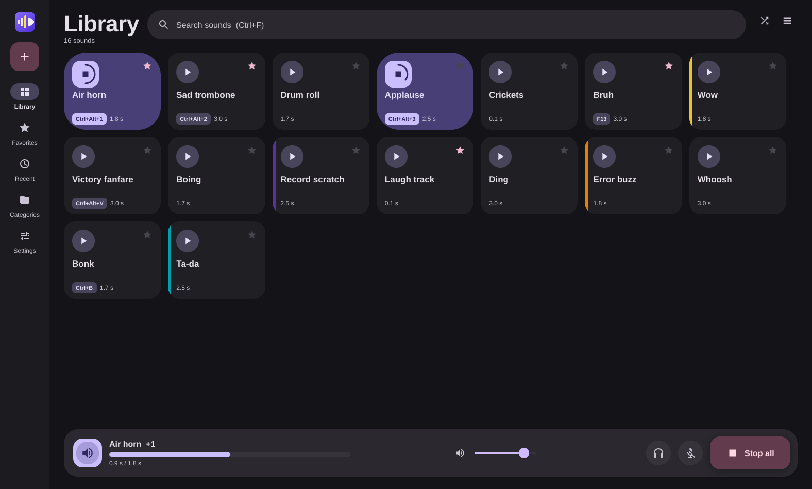
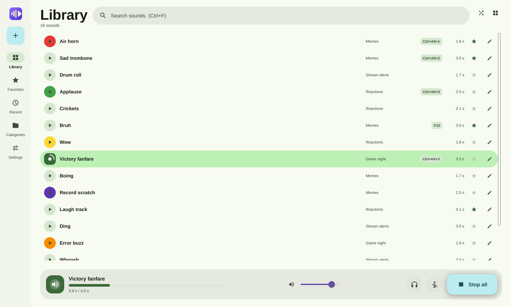
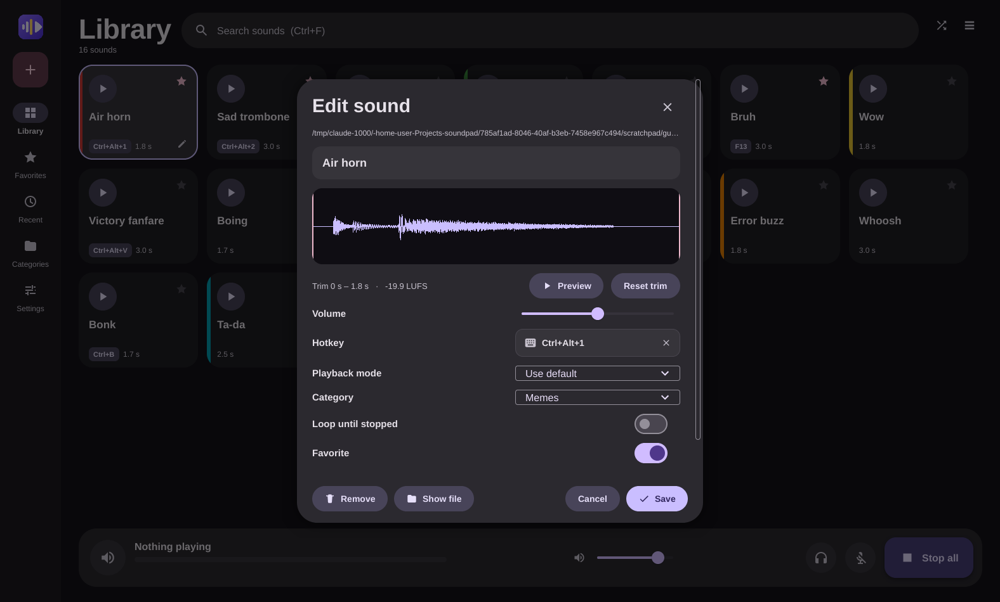
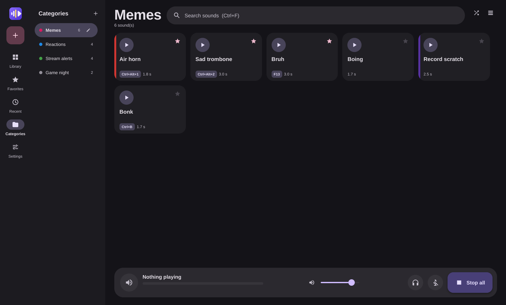
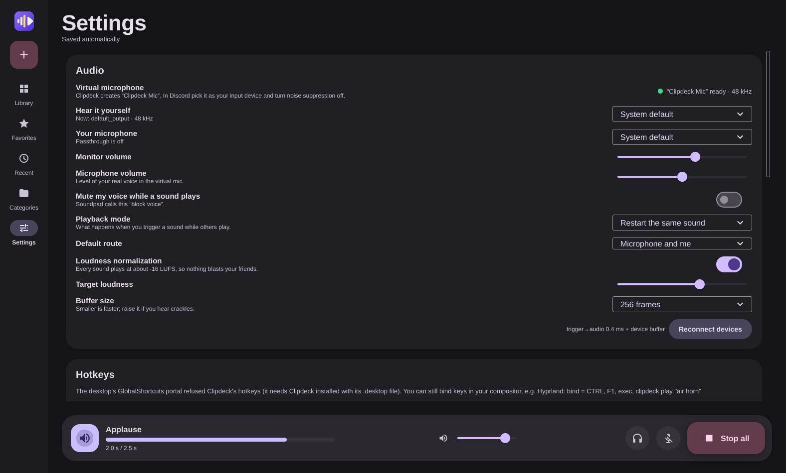

<p align="center">
  
</p>

<h1 align="center">Clipdeck</h1>

<p align="center">
  A fast soundboard for <b>Linux</b> and <b>Windows</b> that plays sound clips into your microphone,<br>
  so your friends in Discord, games and streams hear them. Written in Rust, Material 3 Expressive UI.
</p>

<p align="center">
  
</p>

## What it does

- **Virtual microphone.** Linux: a native PipeWire source called **Clipdeck Mic**. Windows: the free [VB-CABLE](https://vb-audio.com/Cable/) driver (pick **CABLE Output** as your mic). Your real microphone is mixed in, so you keep talking while sounds play.
- **Windows without a cable (beta).** *Settings → Microphones* can put the sounds straight into your real microphone, the way Soundpad does, so nothing changes in Discord. It's opt-in and asks for administrator rights once.
- **Recorder.** Record what you hear (a friend's line, a game moment) or your microphone with one click; silence is trimmed, the level is normalized and the clip lands in your library.
- **Hear it yourself.** A separate monitor output with its own volume, or "only me" playback.
- **Instant triggering.** Global hotkeys, clicks, the keyboard, or the command line. Trigger to render is about 3 ms. Clips are decoded once and kept in memory; long files stream from disk.
- **Loudness normalization** (EBU R128, default −16 LUFS), so the air horn is not 20 dB louder than everything else.
- **Playback modes:** overlap, restart the same sound, or stop others first. Also loop, per-sound volume, and trim with a waveform view.
- **Player:** pause, seek, previous/next, and "when a sound ends: stop / play the next / repeat".
- **Push-to-talk and karaoke delays**, and a **voice-activation sound** that opens Discord's voice activation before each sound.
- **Library:** drag and drop, file picker or watched folders. Categories, favorites, recently played, colors, and instant fuzzy search (just start typing).
- **Soundpad migration:** imports and exports Soundpad `.spl` sound lists byte-for-byte (hotkeys, categories, colors and play counts carry over). The CLI also understands Soundpad's remote-control commands (`DoPlaySound(3)`), so existing scripts keep working.
- Tray icon, start minimized, close to tray, and everything saves automatically.

| | |
|---|---|
|  |  |
|  |  |

## Install

### Linux

Requirements: PipeWire (with `pipewire-pulse` for Discord and browsers). Works on Wayland and X11.

- **AppImage:** download `Clipdeck-*-x86_64.AppImage` from [Releases](https://github.com/qwerpik/clipdeck/releases), `chmod +x` it and run it.
- **Tarball:** `clipdeck-*-linux-x86_64.tar.gz` contains the binary, the `.desktop` file and icons.
- **Arch / AUR:** a `PKGBUILD` lives in [`packaging/aur`](packaging/aur/PKGBUILD) (`makepkg -si` in that folder).
- **From source:** see [Building](#building).

### Windows 10/11

1. Install **VB-CABLE** from <https://vb-audio.com/Cable/> (free, needs a reboot). It's the virtual microphone driver.
2. Run `Clipdeck-*-setup-x64.exe`, or unzip the portable build (settings are kept next to `clipdeck.exe`).

Clipdeck finds VB-CABLE automatically. If it's missing, the app tells you where to get it.

**No cable (beta):** skip step 1 and turn on your microphone in *Settings → Microphones* instead (or tick "Put Clipdeck's sounds into my microphone" in the installer). Discord keeps using your normal mic. If it doesn't work on your PC, run `clipdeck micfx uninstall` and use VB-CABLE.

**"Windows protected your PC":** the builds aren't code-signed yet, so SmartScreen warns on first launch. Click **More info → Run anyway**. Checksums are in `SHA256SUMS.txt` on the release page.

## Use it in Discord (and everything else)

| | Linux | Windows |
|---|---|---|
| Input device in Discord / OBS / your game | **Clipdeck Mic** | **CABLE Output (VB-Audio Virtual Cable)** |
| Noise suppression | Turn **off** Krisp/noise suppression, or it eats your sounds | same |
| Your voice | Mixed in by Clipdeck ("microphone" toggle in the bottom bar) | same |

Play a sound: click its card, press its hotkey, or run `clipdeck play "air horn"`.

## Hotkeys

- **Per sound:** open a sound's editor (pencil icon, right-click or `F2`), click **Hotkey** and press a combination.
- **Stop all / pause / record:** in *Settings → Hotkeys* (default stop-all: `Ctrl+Alt+S`).
- **Random from a category:** in the category's editor.
- **Windows and X11:** system-wide hotkeys via `RegisterHotKey` / XGrabKey.
- **Wayland:** through the desktop's *GlobalShortcuts* portal (KDE, GNOME 48+, Hyprland). Some compositors only allow it for installed apps, and some let you bind keys yourself. The simplest setup, and the most reliable on every compositor, is to bind keys to the CLI:

```ini
# ~/.config/hypr/hyprland.conf
bind = CTRL ALT, 1, exec, clipdeck play "air horn"
bind = CTRL ALT, 2, exec, clipdeck play "#2"          # second sound in the library
bind = CTRL ALT, S, exec, clipdeck stop
bind = CTRL ALT, M, exec, clipdeck mic                 # toggle your real mic
bind = SUPER, F12, exec, clipdeck toggle               # show/hide the window
```

Keyboard inside the window: type to search, arrows to move, `Enter` to play, `Space` to stop all, `F2` to edit, `Esc` to clear, and `Ctrl+1…5` to switch pages.

## Command line

`clipdeck` with no arguments starts the app. With a subcommand it talks to the running app over a local socket (a named pipe on Windows):

```text
clipdeck play <name|id|#pos|file> [--mic|--monitor]   play (standalone if the app isn't running)
clipdeck stop [<name>]          stop one sound or everything
clipdeck pause | next | previous | random | mic | monitor
clipdeck seek <s|+s|-s>         jump in the playing sound
clipdeck record [speakers|mic|stop]   record into the library (standalone: --seconds N --out f.wav)
clipdeck volume [0-100]
clipdeck list | status | devices | paths
clipdeck show [library|favorites|recent|categories|settings] | hide | toggle | quit
clipdeck add <files or folders>…
clipdeck import <list.spl>      Soundpad list (+ stats.spl next to it)
clipdeck export <list.spl>
clipdeck rc 'DoPlaySound(3)'    raw command, Clipdeck or Soundpad syntax
clipdeck micfx status|install|uninstall|test   Windows: the in-microphone effect
clipdeck serve                  run without a window (engine + hotkeys + IPC)
clipdeck bench                  measure latency, startup, idle CPU and RAM
```

## Coming from Soundpad

1. In Soundpad: *File → Save sound list…* (or take `%APPDATA%\Leppsoft\soundlist.spl`).
2. In Clipdeck: *Settings → Library → Import .spl* (or `clipdeck import soundlist.spl`). If `stats.spl` sits next to it, play counts come along.
3. Exported lists use relative paths like Soundpad's, so a folder with its `.spl` can be moved between machines.

Soundpad behavior was studied from the shipped program (see [`re/findings.md`](re/findings.md) and [`re/parity.md`](re/parity.md)). Clipdeck is an independent project, not affiliated with or endorsed by Leppsoft.

## Performance

Measured with `clipdeck bench` (Linux, PipeWire, release build, 256-frame buffer):

| Metric | Target | Measured |
|---|---|---|
| Trigger → sound rendered (excl. device buffer) | < 20 ms | 2.9 ms median, 5.3 ms worst |
| Cold start → window shown | < 300 ms | 60 ms; 120 ms with 1,500 sounds |
| Idle CPU | ≈ 0 % | 0.6 % (two live audio streams) |
| Idle RAM (no cached clips) | < 60 MB | 43 MB (software renderer) |

The UI uses Slint's software renderer by default, because the GPU driver alone maps about 70 MB. Turn on *Settings → Window → GPU rendering* for very large or high-DPI windows.

## How it works

```
crates/
  core/      library model, TOML config, fuzzy search, Soundpad .spl import/export, IPC protocol
  audio/     symphonia decode → rubato resample → clip cache → lock-free mixer (rtrb), EBU R128 loudness
  platform/  virtual mic (PipeWire node / VB-CABLE), global hotkeys (Win32, X11, Wayland portal), IPC
  ui/        Slint UI (Material 3 Expressive) + AppCore shared with the headless daemon
  cli/       the `clipdeck` binary
re/          reverse-engineering notes about Soundpad 4.0.35
```

- One mixer runs inside each output callback (monitor and virtual mic). The control side talks to it only through SPSC ring buffers and atomics. The callback never allocates, locks, logs or touches files, and finished voices are freed on a housekeeping thread.
- The Linux virtual mic is a PipeWire stream with `media.class = Audio/Source`, which apps list as a microphone. Your real mic is captured, resampled without allocation, and mixed in.
- Clips up to 60 s are decoded once to `f32` at the device rate and cached (LRU, 512 MB). Longer files stream from disk.

## Building

```sh
# Arch:   sudo pacman -S rust clang pipewire alsa-lib fontconfig libxkbcommon
# Debian: sudo apt install libasound2-dev libpipewire-0.3-dev libspa-0.2-dev clang libclang-dev libxkbcommon-dev libwayland-dev libfontconfig1-dev
cargo build --release -p clipdeck
./target/release/clipdeck
```

On Windows, a stable Rust toolchain is enough. CI runs fmt, clippy (`-D warnings`) and tests on Linux and Windows, and tagged releases build the AppImage, tarball, portable zip and installer.

## License

GPL-3.0-or-later. See [LICENSE](LICENSE). Icons and artwork are original to this project.
